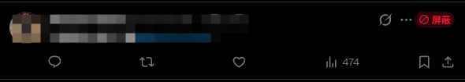
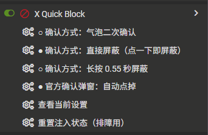
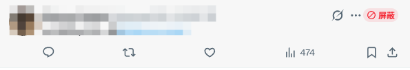
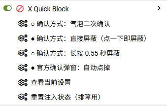

# X 快捷屏蔽 · Quick Block for X

在推文右上角「…」按钮旁注入一个红色【屏蔽】胶囊。点击后**复放 X 官方原生点击链**完成屏蔽。

**生效范围：所有出现推文的位置** —— 首页时间线、帖子详情页的**评论区（每条回复各自有按钮）**、搜索/列表/书签、个人主页时间线、以及聚焦推文视图。

不调用任何私有 API、不处理 `csrf` / `bearer token`、不自己发请求。

- 脚本：[x-quick-block.user.js](x-quick-block.user.js)（v1.3.1）
- 测试：[test/e2e.cjs](test/e2e.cjs)（jsdom 无头端到端，93 项断言）

---

## 界面预览

| 推文右上角的【屏蔽】按钮 | 篡改猴菜单里的确认方式开关 |
| :---: | :---: |
|  |  |
|  |  |

> 截图中推文正文与头像已打码处理。
> 菜单里 ● 表示当前生效项 —— 图中示例为「直接屏蔽 + 官方弹窗自动点掉」= **零确认模式**（点一下即屏蔽）。

---

## 1. 安装

1. 安装 [Tampermonkey](https://www.tampermonkey.net/)（或 Violentmonkey）。
2. 三种装法任选：
   - 点 **[一键安装](https://raw.githubusercontent.com/ShimaRin-x/x-quick-block/main/x-quick-block.user.js)**（篡改猴会弹出安装页）；
   - 把 `x-quick-block.user.js` **直接拖进 Chrome 窗口**；
   - 或篡改猴面板 → **实用工具 → 从文件导入**。
   > 脚本已配置 `@downloadURL` / `@updateURL`，之后篡改猴可自动检查更新。
3. ⚠️ **Chrome 必做一步**（MV3 限制，不做则篡改猴无法执行任何用户脚本）：
   打开 `chrome://extensions/?id=dhdgffkkebhmkfjojejmpbldmpobfkfo` → 右上角开启**开发者模式** → 打开**「允许用户脚本」**。
4. 刷新 `x.com`。推文「…」旁会出现红色【屏蔽】；验收：

   ```js
   __XQB__.selftest()   // 期望 problems: 0，且 injected === withCaret
   ```

---

## 2. 使用

| 操作 | 结果 |
| --- | --- |
| 单击红色【屏蔽】 | 默认弹出确认气泡（内嵌 X 原生菜单行预览） |
| 气泡内 `Enter` / 点「确认屏蔽」 | 执行屏蔽；随后自动点击 X 官方确认弹窗 |
| 气泡内 `Esc` / 点「取消」 / 按钮滚出视口 | 取消，不产生任何动作 |
| 官方弹窗出现后 300ms 内按 `Esc` | **反悔窗口**：中止并关掉官方弹窗 |
| **`Alt+Shift+K`** | 循环切换确认方式：气泡 → 直接屏蔽 → 长按 |
| 篡改猴图标 → 本脚本 | 菜单中直接点选确认方式（当前项带 ●） |
| 悬停某条推文按 `Alt+Shift+B` | 等价于点该推文的【屏蔽】按钮 |
| 帖子详情页评论区 | **每条回复都有自己的【屏蔽】按钮**，点谁屏蔽谁 |
| 长按模式 | 长按 550ms 执行，短按只提示 |

---

## 3. 确认方式开关（v1.3.0 新增）

三种模式，**运行中随时可切、自动记住**（篡改猴菜单 / `Alt+Shift+K` / 控制台）：

| 模式 | 单击按钮后 | 适合 |
| --- | --- | --- |
| `popover` 气泡二次确认（默认） | 弹气泡 → 你确认 → 执行 | 日常，防手滑 |
| **`none` 直接屏蔽** | **立即执行，零确认** | 批量清理垃圾号 / 广告 |
| `longpress` 长按屏蔽 | 短按只提示，长按 0.55s 才执行 | 既要快又要防误触 |

再叠加一个独立开关「**官方确认弹窗：自动点掉 / 留给你手动点**」：

| 组合 | 你实际要点几次 |
| --- | --- |
| `popover` + 自动点掉（默认） | 1 次（你自己气泡） |
| **`none` + 自动点掉** | **0 次：点一下即屏蔽** |
| `none` + 手动点 | 1 次（官方那个弹窗） |
| `longpress` + 自动点掉 | 0 次（长按即屏蔽） |

三种入口：

```js
// 1) 篡改猴图标 → 脚本菜单（菜单项前面的 ● 表示当前生效项）
// 2) 页面内快捷键
Alt+Shift+K                // 循环切换
// 3) 控制台
__XQB__.setMode('none')            // 直接屏蔽
__XQB__.setMode('popover')         // 气泡确认
__XQB__.setMode('longpress')       // 长按
__XQB__.setAutoConfirmNative(true) // 自动点掉官方弹窗
__XQB__.status()                   // 看当前设置
```

> ⚠️ `none` + 自动点掉 = **点一下就真的拉黑了**，没有任何拦截。
> 切换后对**已注入的按钮立即生效**：监听器在事件发生时读当前模式，而不是创建时绑定
> （早期实现按创建时绑定，运行中切到长按会导致短按被旧监听直接屏蔽 —— 已由测试覆盖修复）。

---

## 4. 可调参数（脚本顶部 `CONFIG`）

| 键 | 默认 | 说明 |
| --- | --- | --- |
| `debug` | `false` | 详细日志。也可控制台执行 `__XQB__.config.debug = true` |
| `confirmMode` | `'popover'` | `'popover'` / `'none'` / `'longpress'`，建议用菜单或 `setMode()` 改 |
| `longPressMs` | `550` | 长按阈值 |
| `autoConfirmNative` | `true` | 已确认后是否自动点掉官方弹窗 |
| `nativeConfirmDelayMs` | `300` | 自动点确认前的反悔窗口（ms） |
| `buttonStyle` | `'pill'` | `'pill'` 红胶囊（醒目）/ `'icon'` 仅图标（最原生） |
| `matchCaretHeight` | `true` | 高度跟随 caret 实测值（实测 20px），**保证不改动 X 布局** |
| `buttonPosition` | `'after'` | 相对「…」的位置：`'after'` / `'before'` |
| `cloneNativeIcon` | `true` | 克隆官方 SVG 作按钮图标 |
| `clonePreviewRow` | `true` | 气泡内嵌克隆版官方菜单行 |
| `hotkey` | `'Alt+Shift+B'` | 屏蔽鼠标悬停的推文 |
| `modeHotkey` | `'Alt+Shift+K'` | 循环切换确认方式 |
| `warmUpCapture` | `false` | 空闲时预热抓一次官方视觉（会闪现一次菜单） |
| `maxPerFrame` | `24` | 每帧最多处理的推文数 |
| `verifyThrottleMs` | `1200` | 同一推文的复用校验节流 |
| `safetyScanMs` | `4000` | 低频兜底扫描间隔（同时负责 URL 变化检测） |
| `i18n.blockRe / unblockRe` | 多语言正则 | 换语言/改版时改这里 |

---

## 5. 兼容性排查（X 改版时怎么办）

菜单项采用**三级降级**：`data-testid` → 多语言文案 → （可选）激进兜底，单一选择器失效通常不致命。

### 首选排查手段

```js
__XQB__.diagnose()      // 环境体检：推文数 / 可注入数 / 已注入数 / 主题 / 是否忙
__XQB__.selftest()      // 逐条推文自检，列出未注入的推文（评论区验收就用它）
__XQB__.inspectMenu()   // 打开一条推文的原生菜单，打印每项 testid 与文案，然后自动关闭
```

`inspectMenu()` 在真实站点上的输出示例：

```
testid: "block"   text: "屏蔽 @xxx"     ← 命中
testid: "report"  text: "举报 帖子"
testid: null      text: "对此帖子不感兴趣"
```

### 拿到真实 testid 后怎么改

脚本的 `SEL` 注册表是**唯一需要改的地方**：

```js
const SEL = {
  tweet:       ['article[data-testid="tweet"]'],
  caret:       ['[data-testid="caret"]'],
  menu:        ['[role="menu"]', '[data-testid="Dropdown"]'],
  menuItem:    ['[role="menuitem"]'],
  blockItem:   ['[data-testid="block"]'],                    // ← 屏蔽项
  unblockItem: ['[data-testid="unblock"]'],                  // ← 取消屏蔽项
  confirmBtn:  ['[data-testid="confirmationSheetConfirm"]'], // ← 官方弹窗确认
  cancelBtn:   ['[data-testid="confirmationSheetCancel"]'],
  userName:    ['[data-testid="User-Name"]'],
  layers:      ['#layers'],
};
```

也可运行时不改文件、临时覆盖：

```js
__XQB__.sel.blockItem = ['[data-testid="block"]', '[data-testid="blockUser"]'];
__XQB__.rescan();
```

### 常见症状对照表

| 症状 | 原因 | 处理 |
| --- | --- | --- |
| 完全没有按钮 | `caret` 选择器失效或结构变了 | `diagnose()` 看 `injectable` 是否为 0，再 `inspectMenu()` |
| 全文没有按钮且 `__XQB__` 未定义 | 篡改猴没在跑脚本 | 检查 `chrome://extensions` 里「允许用户脚本」是否打开 |
| 提示「菜单里没有「屏蔽」项」 | `blockItem` 失效且文案兜底未命中 | `inspectMenu()` 取真实 testid 写入 `SEL.blockItem` |
| 提示「原生菜单打开超时」 | 菜单容器选择器失效 | `inspectMenu()` 看菜单是否被找到；检查 `SEL.menu` |
| 点击无效、提示「X 可能已改版」 | 菜单项点击未生效 | `inspectMenu()` 后回报 |
| 菜单关不掉、页面残留浮层 | 关闭机制失效 | 现用 caret toggle（实测有效）；兜底 Esc + 外部 mousedown |
| 按钮样式错乱/被裁切 | 操作栏容器结构变了 | 调 `buttonPosition`；或换 `buttonStyle: 'icon'` |
| 官方弹窗没被自动点 | `confirmBtn` 失效 | 会退回「按文案找按钮」；仍失败则提示你手动点，不谎报成功 |

### 一条命令验收（评论区）

```js
__XQB__.selftest()
```

以一条有 28 条回复的帖子为例，期望：

```
tweets: 29   withCaret: 29   injected: 29   markedDone: 0   problems: 0
```

- `problems > 0`：会同时打印未注入的具体推文（序号 + handle）
- `tweets ≠ injected`：多半是 X 正在懒加载/回收回复节点，滚动一下再执行
- 只看环境概况：`__XQB__.diagnose()`

> **实测参考**（真实 x.com 帖子详情页）：29 条推文（主贴 + 28 回复）中**每条回复都有自己的 `[data-testid="caret"]`**；按同样几何插入后容器自适应、按钮 46×20 不裁切、**caret 不被拉伸**；分别点第 1/2/5 条回复，菜单项为「屏蔽 @alice」「屏蔽 @bob」「屏蔽 @carol」——与各自作者一一对应（此处为化名，真实用户名已隐去）。

---

## 6. 架构速览

```
Scanner    MutationObserver(子节点) → 脏队列(Set) → rAF 批量 + 每帧限额
           caret 节点身份 + 推文指纹 双校验，识别时间线 DOM 节点复用
           4s 兜底扫描（同时用 URL 轮询补 SPA 路由，隔离世界里 patch history 无效）
Injector   在 [data-testid="caret"] 旁插入 .xqb-btn
           高度跟随 caret 实测值 → 对 X 布局零影响；图标 = 克隆官方 <svg>
Confirm    气泡二次确认，内嵌「克隆 + computed style 内联」的官方菜单行
           事件监听统一绑定、在事件发生时读当前模式 → 运行中切开关立即生效
NativeFlow 互斥队列串行化，复放真实点击链：
           caret.click() → 命中 [data-testid="block"] → 点它 → 官方弹窗 → 确认
           finally 用 caret toggle 收尾（实测 Esc 关不掉该菜单）
```

### 为什么不能「克隆菜单项当按钮、直接触发它的 click」

React 17+ 用根容器事件委托，靠节点上的 `__reactFiber$` / `__reactProps$` 这两个 **JS expando** 定位 fiber；`cloneNode()` 只复制 HTML 属性、不复制 expando。克隆体没有 fiber，React 的 `getClosestInstanceFromNode` 会顺着 `parentNode` 找到**外层推文**的 fiber，事件被派发到错误链路 —— 实际效果是打开推文详情页。

所以：**克隆只用于外观与预览，动作统一走原生真实节点复放。**

---

## 7. 已知限制（诚实声明）

1. **未在真实账号上执行过最终屏蔽动作**：验证时把链路推到了官方确认弹窗出现，然后**只点了「取消」**，事后刷新核对目标账号状态未变。因此本脚本的全部选择器（含 `confirmationSheetConfirm` / `confirmationSheetCancel`）都已在真实站点逐一确认，而「点下确认按钮之后」的最终状态由 X 官方逻辑保证 —— 那一步正是脚本完整复刻的点击链。
2. X 的界面文案/语言包变化会影响文案兜底；`data-testid` 变化才会影响主路径。
3. 依赖「点击 caret 打开官方菜单」这一交互。若 X 改成 hover 展开菜单，需改 `openCaretMenu()`。
4. 屏蔽是**不可逆的负面社交动作**。默认保留气泡二次确认；`confirmMode: 'none'` + `autoConfirmNative: true` 等于零确认，请谨慎。

---

## 8. 真实站点实测记录

在真实 `x.com`（暗色模式）上实测并据此修正了以下设计：

| 实测事实 | 对代码的影响 |
| --- | --- |
| `[data-testid="caret"]` 是 `BUTTON`，`aria-expanded` 会 `false→true` | 用作菜单展开的快信号 |
| caret 父链宽度仅 `18.75px`、高 `20px` | 原设计 34px 按钮会把 caret 拉成 19×34 竖长胶囊；改为跟随 caret 实测高度 |
| 插入后父容器宽度自适应增长（19→55px），`nameLost = 0`、命中测试为按钮自身、无裁切 | 插入点 `caret.parentElement` 确认可用 |
| 真实菜单项确认存在 `data-testid="block"`（文案「屏蔽 @用户名」） | 主选择器确认正确 |
| 派发 Escape 时 X 的处理器确实执行（`defaultPrevented=true`）但**菜单不关**；`caret.click()` 再点一次必关 | 关闭机制改为 caret toggle 优先 |
| 完全可见的真实菜单 `checkVisibility({checkOpacity,checkVisibilityCSS})` 返回 **false**（其 computed `opacity` 为 `"0"`） | 删除基于 opacity 的可见性判断，否则功能在真实站点直接失效 |
| 点「屏蔽」后官方确认弹窗出现，确认按钮 `data-testid="confirmationSheetConfirm"`（文案「屏蔽」）、取消按钮 `data-testid="confirmationSheetCancel"`（文案「取消」） | 主路径选择器齐全，文案兜底作二次保险 |
| **确认弹窗消失后，背后的下拉菜单仍留在页面上**（X 不会自己收掉） | 弹窗流程结束后必须再 toggle 一次 caret；手动确认模式下会在弹窗消失后自动清理 |
| 帖子详情页评论区 29 条推文，每条回复都有独立 caret，插入几何与时间线完全一致 | 评论区无需额外适配，同一套注入逻辑直接覆盖 |
| 分别点第 1/2/5 条回复的 caret，菜单项为「屏蔽 @alice / @bob / @carol」 | 每条回复的按钮精确对应其作者 |
| `<style>` 注入、Shadow DOM 样式、MutationObserver 均可用（CSP 不拦） | 样式与浮层方案确认可用 |
| 运行中切换确认方式时，按创建时绑定的监听器会保留旧行为（切到长按后短按被直接屏蔽） | 改为统一绑定 + 事件发生时读模式（由测试锁定） |

---

## 9. 回归测试

`test/e2e.cjs` 是一套 jsdom 无头端到端测试（**93 项断言**），用「仿 X DOM + 仿官方菜单/弹窗」跑通全链路：

```bash
npm install            # 首次：装 jsdom
npm test               # 期望：通过 93 项，失败 0 项
```

覆盖：注入与几何、tooltip、防冒泡、二次确认、取消、Esc 反悔、悬挂菜单清理、文案兜底、
已屏蔽账号、节点复用（含已屏蔽节点被复用）、菜单无屏蔽项时的收尾、**评论区多推文**、
**三种确认方式切换 / 长按短按区分 / 官方弹窗手动模式 / 设置持久化**、引用推文不注入、调试 API。

测试环境刻意比真实环境更严格：`Element.prototype.checkVisibility` 固定返回 `false`（复刻真实站点陷阱）、
Esc **不允许**关闭菜单（复刻实测行为）—— 生产代码若退回旧实现会立刻崩测试。

变异测试（证明用例不是空过）：

```bash
npm run mutants
$env:XQB_SCRIPT=".\tools\mutantA.user.js"; node test/e2e.cjs   # realClick 失效 → 崩 9 项
$env:XQB_SCRIPT=".\tools\mutantB.user.js"; node test/e2e.cjs   # 文案兜底失效 → 精确崩 1 项
```

静态引用体检（抓未声明标识符）：

```bash
node tools/static-check.cjs x-quick-block.user.js
```

---

## 10. 许可

MIT © ShimaRin-x
